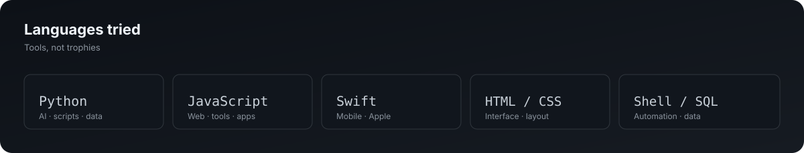
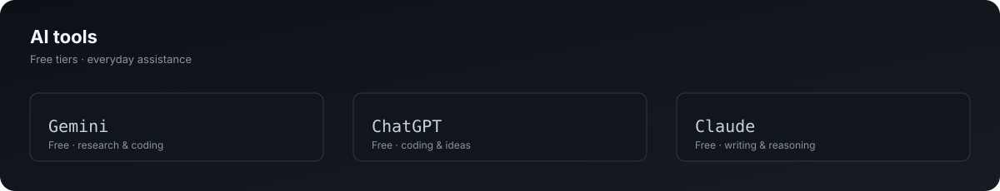

## Languages tried

## AI tools

Quick list

- **Languages:** Python, JavaScript, Swift, HTML, CSS, Shell, SQL
- **AI tools:** Gemini Free, ChatGPT Free, Claude Free

## Recent public work

No public projects to display.
